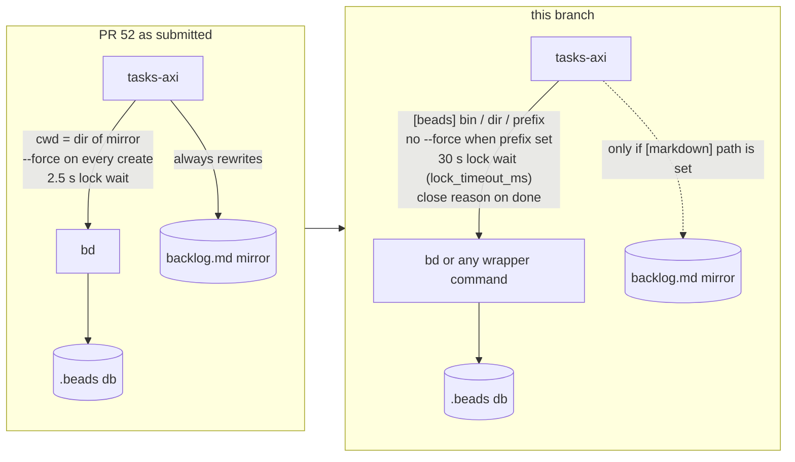

# Beads backend: before -> after

| Concern | Before | After |
| --- | --- | --- |
| Mirror | always written, path doubles as workspace | optional; none unless `[markdown] path` / `--file` |
| Binary / dir / prefix | `bin`, `dir` only | `bin`/`binary`, `dir`/`path`, `prefix`; wrapper works with `dir` unset |
| Id handling | `--force` always | prefix checked up front, `--force` only without a prefix |
| Native bd data | ignored | priority, issue type, dates read for issues without `tasks_axi` metadata |
| Done | no close reason | PR link (or `Closed`) recorded as bd close reason |
| Lock wait | 2.5 s then `LOCKED` | 30 s default, `lock_timeout_ms` configurable |
